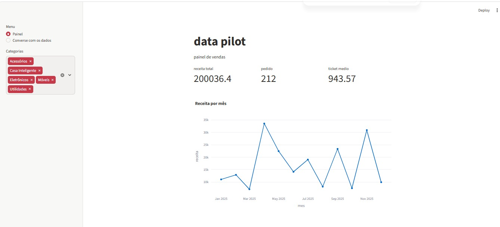
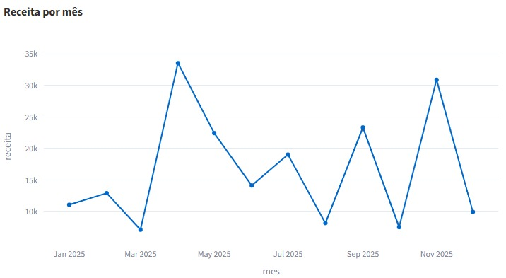
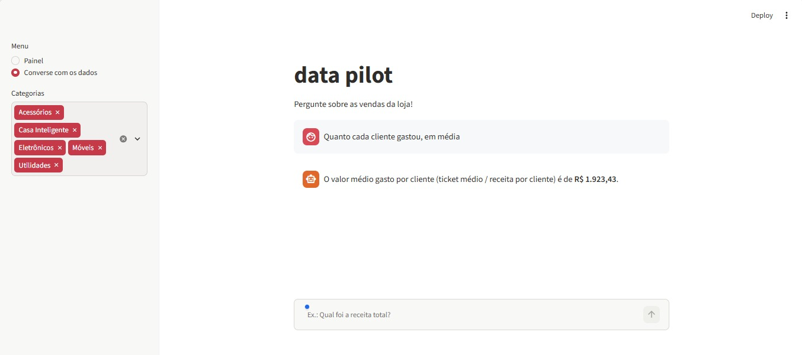

# 🤖 Data Pilot

Painel de vendas em Python que também conversa: você pergunta em português, e um agente de IA responde com as métricas que o código calculou.

## 📖 O que o Data Pilot faz

O Data Pilot tem dois menus:

- **📊 Painel:** mostra a receita total, os pedidos, o ticket médio e a receita por mês, com filtro por categoria.
- **💬 Converse com os dados:** o usuário faz uma pergunta em português, e a IA escolhe sozinha qual ferramenta usar para responder.

A regra principal do projeto é: **o Python calcula, a IA só explica**. Assim, a IA não inventa números: todo número da resposta vem de uma função do código.

## 📂 De onde vêm os dados

Como não encontrei a planilha original usada nas aulas, usei uma **planilha de vendas de exemplo** (`data/sales.csv`), com 248 pedidos de uma loja em 2025. Ela foi criada com "sujeiras" de propósito, como acontece no mundo real:

- o status escrito de jeitos diferentes (`Concluído`, `CONCLUIDO `, `concluido`...)
- pedidos repetidos
- datas em formato de texto

O arquivo `limpeza.py` arruma tudo isso e salva a planilha limpa em `data/vendas_limpas.csv`.

## 🏗️ Como o projeto está organizado

O projeto é dividido em camadas, cada uma num arquivo:

| Arquivo | O que faz |
|---|---|
| `limpeza.py` | 🧹 limpa os dados: datas, status, duplicados e a coluna de receita |
| `metricas.py` | 🧮 calcula as métricas de vendas, uma função por pergunta de negócio |
| `app.py` | 🎨 mostra o painel e o chat no navegador, com o Streamlit |
| `chat.py` | 💬 conecta com a IA pelo OpenRouter e define as ferramentas que ela pode usar |

## 🛠️ Como instalar e rodar

**1. Instale as bibliotecas:**

```bash
python -m pip install pandas streamlit plotly python-dotenv openai
```

**2. Configure a chave da IA:**

Crie uma conta gratuita no [OpenRouter](https://openrouter.ai), gere uma chave de API, e copie o arquivo `.env.example` para um arquivo novo chamado `.env`. Depois, coloque a sua chave nele:

```
OPENROUTER_API_KEY=sua_chave_aqui
OPENROUTER_MODEL=openrouter/free
```

> ⚠️ O arquivo `.env` guarda a chave secreta e está no `.gitignore`, então ele **não** vai para o GitHub.

**3. Limpe os dados:**

```bash
python limpeza.py
```

**4. Rode o app:**

```bash
python -m streamlit run app.py
```

## 🔧 As ferramentas que o modelo pode chamar

No chat, a IA recebe uma lista de "ferramentas", cada uma com um nome e uma descrição. Lendo as descrições, ela escolhe sozinha qual função chamar. Quem faz a conta é sempre o Python.

| Ferramenta | O que calcula |
|---|---|
| `receita_total` | a receita total dos pedidos concluídos |
| `total_pedidos` | quantos pedidos foram concluídos |
| `ticket_medio` | quanto, em média, cada pedido gastou |
| `clientes_unicos` | quantos clientes diferentes compraram |
| `taxa_cancelamento` | a porcentagem de pedidos cancelados |
| `receita_por_cliente` ✨ | quanto, em média, cada cliente gastou no total |

## ✨ A melhoria que eu escolhi

Escolhi criar uma **métrica nova**: a **receita média por cliente**. Ela é diferente do ticket médio porque divide a receita pelos **clientes**, e não pelos pedidos. Como um mesmo cliente pode fazer vários pedidos, ela mostra quanto cada cliente vale para a loja. O resultado foi **R$ 1.923,43**, mais que o dobro do ticket médio (R$ 943,57), o que mostra que os clientes costumam voltar para comprar de novo.

Para o chat aprender a responder sobre ela, só precisei de três passos: criei a função no `metricas.py`, escrevi a etiqueta com a descrição no `chat.py`, e coloquei o nome na agenda de funções. Não precisei mudar mais nada: o agente aprendeu sozinho a usar a ferramenta nova.

## 📸 Prints

**Painel:**



**Gráfico de receita por mês:**



**Conversa com os dados:**



## ⚠️ Limitações que eu descobri testando

- O modelo gratuito (`openrouter/free`) escolhe uma IA diferente a cada pergunta, e algumas não sabem usar ferramentas direito. Às vezes, em vez do número, a resposta vem como um texto estranho. Perguntando de novo, normalmente funciona.
- Quando troca de menu, o chat esquece a conversa, porque o Streamlit recarrega a página a cada clique.

## 🔭 Melhorias futuras

- Guardar o histórico da conversa, para o chat não esquecer as mensagens ao trocar de menu.
- Escolher um modelo gratuito fixo que suporte ferramentas, para as respostas ficarem mais estáveis.
- Criar ferramentas com parâmetros, como um período de datas.